# Production Architecture Workflow

## 1. Complete system architecture

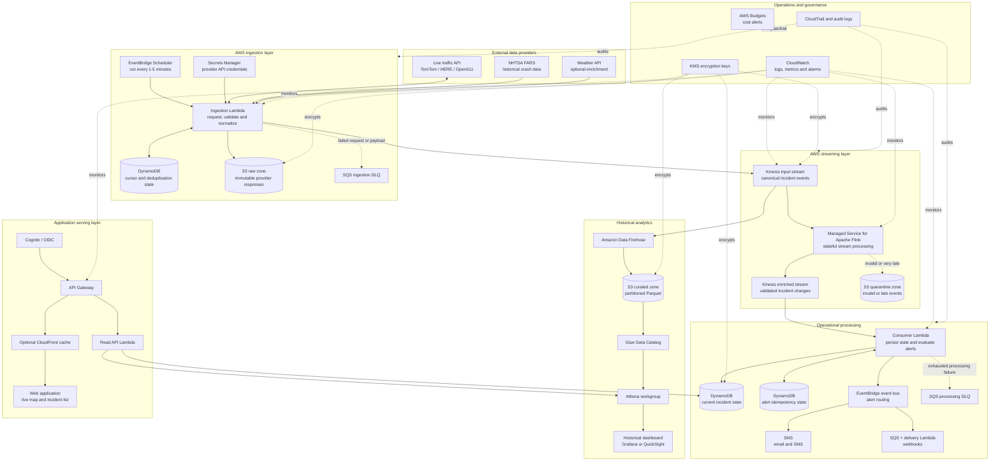

## 2. Main live-event workflow

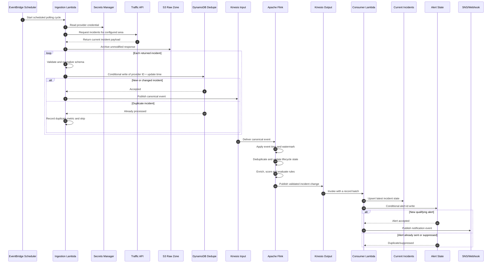

## 3. Flink processing workflow

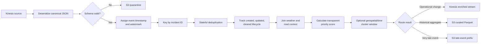

Flink is justified here because the workflow uses keyed state, event time, deduplication, lifecycle transitions, joins, and windows. If the implementation only filters on severity, replace this layer with Lambda event-source filtering until those stateful requirements exist.

## 4. Incident lifecycle

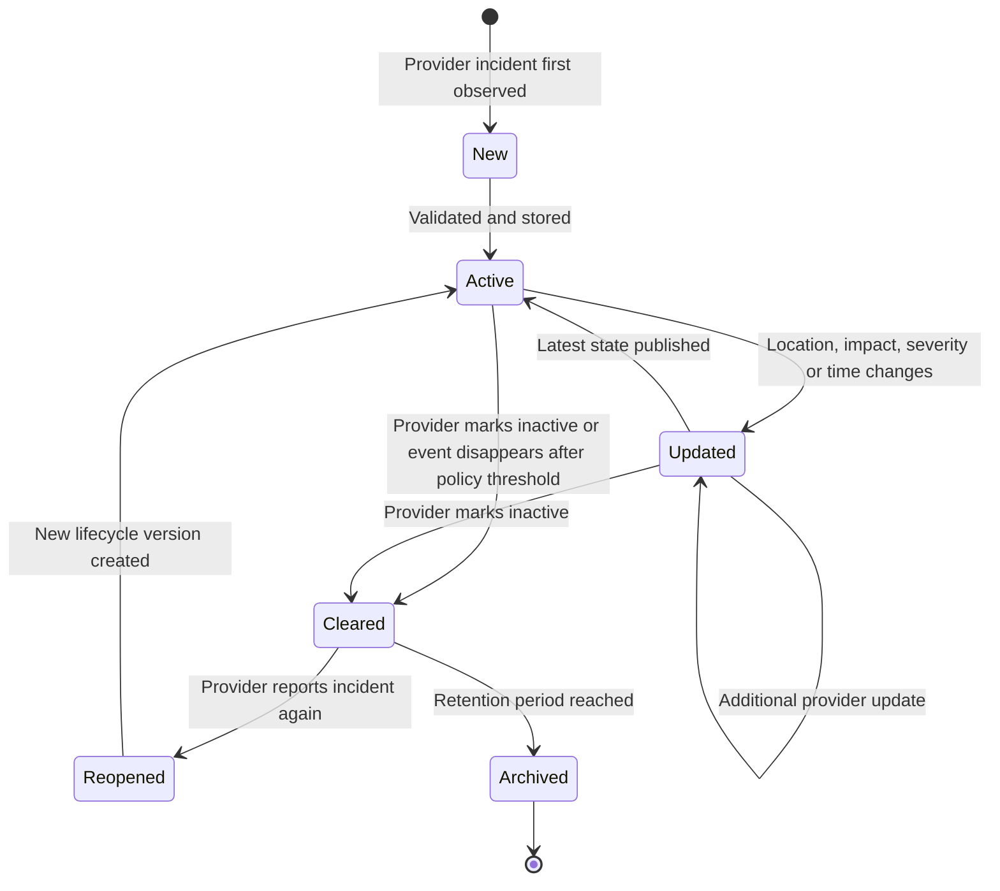

Each transition should retain the source timestamp, ingestion timestamp, previous version, provider, and reason. The current-state table stores the latest version; S3 stores the complete append-only history.

## 5. Alert workflow

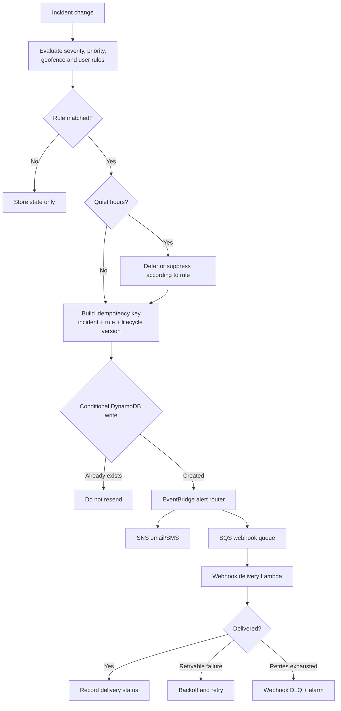

## 6. Historical data workflow

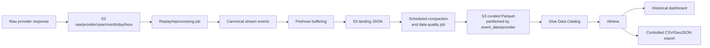

The raw zone provides an audit and replay source. Curated Parquet provides efficient analytical queries. Failed validation records belong in a separate quarantine prefix with a failure reason rather than in the curated table.

## 7. API and application workflow

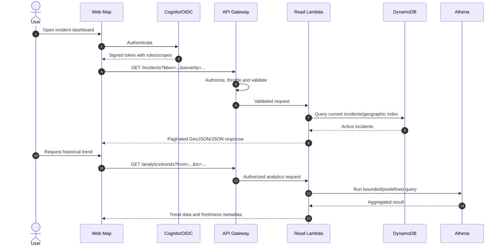

Do not allow arbitrary public Athena SQL. Use bounded, parameterized query templates, enforce date/region limits, cache common results, and expose source/ingestion freshness to users.

## 8. Failure and recovery workflow

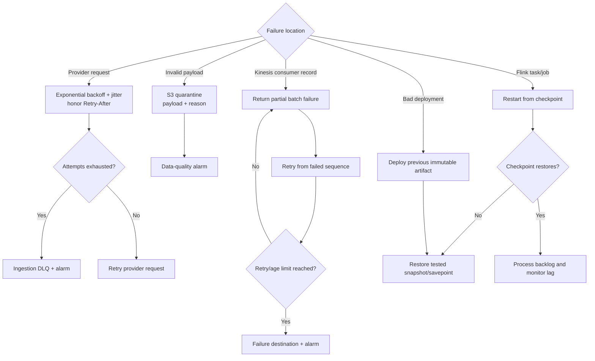

Operational runbooks should define who owns each alarm, how to inspect the failed record, when to replay it, and how to avoid duplicate alerts during recovery.

## 9. Terraform infrastructure workflow

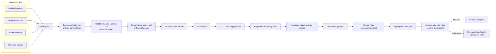

### Terraform module dependency map

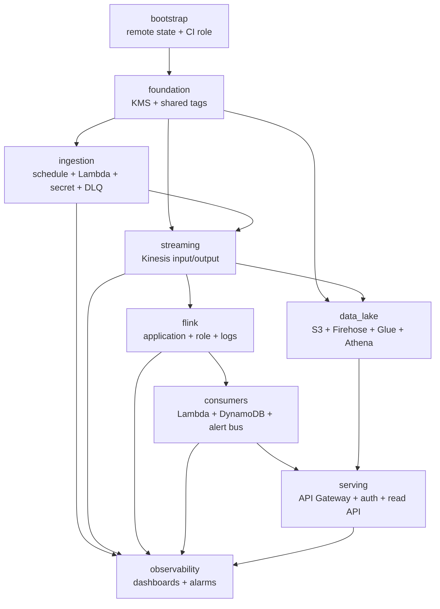

## 10. Repository structure

```text
.
├── app/
│   ├── ingestion/              # Live API adapter and canonical mapper
│   ├── flink/                  # Stateful processing application
│   ├── incident_consumer/      # Current state and alert decisions
│   ├── webhook_delivery/       # Retried external notifications
│   └── read_api/               # Dashboard/API queries
├── schemas/
│   ├── canonical-incident-v1.json
│   └── provider-mappings/
├── infra/
│   ├── bootstrap/
│   ├── modules/
│   │   ├── foundation/
│   │   ├── ingestion/
│   │   ├── streaming/
│   │   ├── flink/
│   │   ├── data_lake/
│   │   ├── consumers/
│   │   ├── serving/
│   │   └── observability/
│   └── environments/
│       ├── dev/
│       ├── staging/
│       └── prod/
├── tests/
│   ├── unit/
│   ├── contract/fixtures/
│   ├── integration/
│   ├── replay/
│   └── load/
├── dashboards/
├── runbooks/
└── .github/workflows/
```

## 11. Build order

Build this architecture as six independently testable milestones:

1. **Foundation:** canonical schema, provider adapter, tests, configuration, and structured logging.
2. **Terraform ingestion:** remote state, IAM, KMS, Secrets Manager, scheduled Lambda, S3 raw storage, DynamoDB dedupe, Kinesis, and DLQ.
3. **Stream processing:** Flink dedupe/lifecycle logic, checkpoints, stable operator IDs, output stream, quarantine, and replay tests.
4. **Operational consumer:** current-state DynamoDB table, idempotent alert state, SNS/webhook routing, partial batch failures, and alarms.
5. **Analytics and UI:** Firehose, curated Parquet, Glue/Athena, secured read API, live map, freshness indicators, and historical charts.
6. **Hardening:** load testing, recovery exercises, security scanning, cost budgets, runbooks, staging promotion, and rollback validation.

Each milestone should produce observable evidence before the next begins. For example, milestone 2 is complete only when one provider fixture is archived, deduplicated, normalized, and visible in Kinesis with alarms configured.

## 12. Lean portfolio variant

If cost is the main constraint, begin with this architecture:

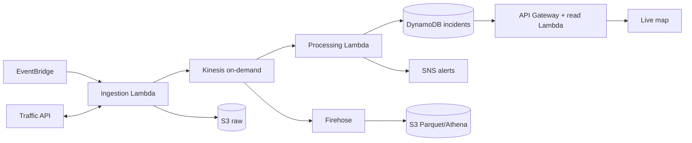

This version still demonstrates event-driven ingestion, streaming, idempotency, a data lake, Infrastructure as Code, and a user-facing product. Add Flink after implementing a requirement that needs stateful event-time processing.

## 13. Recommended implementation choice

For this portfolio project:

- use Open511 or 511 SF Bay for the first live feed;
- deploy the lean variant first with Terraform;
- preserve the Kinesis interface so Flink can be introduced without changing ingestion;
- implement incident lifecycle and five-minute geographic clustering in Flink;
- use DynamoDB for current state and S3/Parquet/Athena for history;
- build a small map that shows event freshness and filter controls; and
- publish measured latency, throughput, replay correctness, and monthly cost in the README.

This produces a complete, defensible project while keeping the first deployment affordable.
