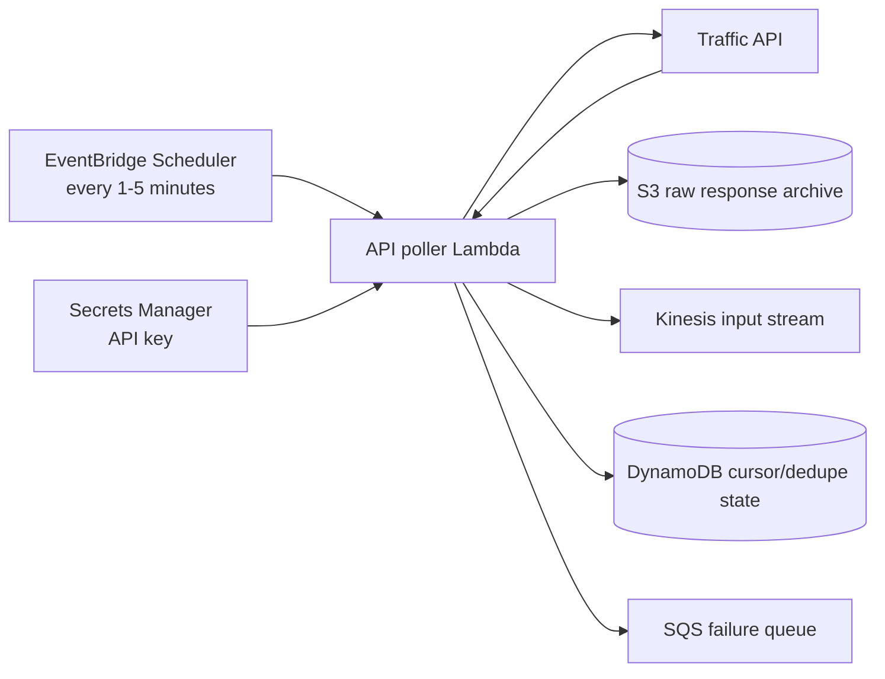
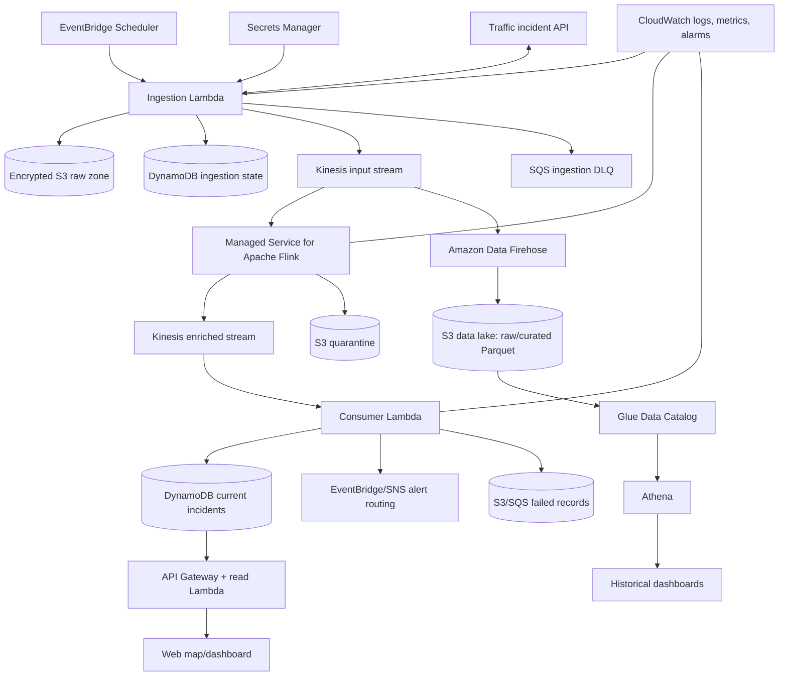

# Production Readiness, Live Data, and Terraform Roadmap

## Executive assessment

The current repository is a useful streaming demonstration, but it is not yet deployable or production-ready. Its strongest idea is the separation between an urgent streaming path and a historical analytics path. Its main weaknesses are inconsistent configuration, incomplete infrastructure, demo-only ingestion, weak failure handling, no automated verification, no deployment process, and no evidence of measured performance.

The best next version should make one coherent vertical slice work end to end:

```text
Live incident API -> ingestion Lambda -> Kinesis -> Flink ->
    1. alerts and operational state
    2. S3 data lake -> Athena
    3. API/dashboard for users
```

Terraform should create the infrastructure, while application artifacts and configuration should be versioned and deployed through CI/CD. This would turn the project from a notebook-based demo into a repeatable engineering portfolio project.

## 1. Critical analysis of the current system

### What is already good

- Kinesis decouples ingestion from processing and permits replay within its retention period.
- Flink is a strong choice if the product needs event-time windows, stateful aggregation, enrichment, deduplication, joins, or complex event patterns.
- The architecture recognizes that operational monitoring and historical analysis are different workloads.
- Serverless/managed AWS services reduce operational burden.
- The dataset contains temporal, geographic, weather, and road-context fields that can support richer analytics.

### What prevents production use

| Area | Current condition | Production consequence | Required change |
| --- | --- | --- | --- |
| Deployment | Resources are created manually and no IaC exists | Environments drift and cannot be reproduced reliably | Manage infrastructure with Terraform |
| Configuration | Stream names and Regions conflict across files | Components do not connect as checked in | Use one Region and inject resource names/ARNs |
| Ingestion | CSV is loaded into memory and replayed three times | Not live, not resumable, and duplicates are intentional | Add a scheduled live API poller with cursors and deduplication |
| Schema | CSV strings are loosely converted to JSON | Type errors and schema drift can break consumers | Define a canonical versioned event schema and validate at ingress |
| Partitioning | `Severity` has very low cardinality | Hot shards and limited parallelism are likely at scale | Partition on stable event ID or a hashed composite key |
| Processing | Flink only performs a simple filter | Cost and complexity are difficult to justify | Add dedupe, enrichment, windows, and stateful rules, or use Lambda filtering |
| Failure handling | Broad exceptions are printed and swallowed | Records can be lost silently | Use structured errors, bounded retries, partial batch failures, and quarantine storage |
| Alerting | Every qualifying event can publish again | Duplicate/noisy alerts reduce trust | Add idempotency, alert lifecycle, suppression, and escalation rules |
| Metrics | City/county are CloudWatch dimensions | High-cardinality custom metrics can become expensive | Keep low-cardinality service metrics; query detailed geography elsewhere |
| Storage | Diagram shows a lake, but it is not configured | No trustworthy replay or historical analysis path | Store immutable raw records and partitioned Parquet curated records |
| Security | IAM, encryption, secret storage, and audit controls are absent | Excess access and exposed API keys are possible | Least-privilege IAM, KMS, Secrets Manager, TLS, logging, and secret scanning |
| Testing | No unit, contract, integration, load, or recovery tests | Correctness and operational limits are unknown | Add automated tests and measured service-level objectives |
| Observability | No alarms, traces, or data-quality dashboard | Failures may remain invisible | Add logs, metrics, alarms, runbooks, and end-to-end lag measurement |
| Product surface | No user-facing API or map exists | The pipeline has no usable operational interface | Build a geospatial dashboard and read API |

### The Flink decision should be deliberate

For the existing rule `Severity > 3`, Flink is more machinery than the transformation requires. Kinesis event filtering plus Lambda could implement a small project more cheaply.

Keep Flink if the next version includes at least some of the following:

- event-time windows such as accidents per road segment over five minutes;
- deduplication keyed by provider and external incident ID;
- stateful incident lifecycle tracking (`created`, `updated`, `cleared`);
- joins with weather, road metadata, or historical risk features;
- late and out-of-order event handling;
- congestion-spike or accident-cluster detection; and
- multiple output streams based on dynamic rules.

That gives a convincing answer to “Why Flink?” in an interview.

## 2. Live and historical data APIs

API availability, pricing, quotas, licensing, retention rights, and redistribution terms can change. Verify the provider's current commercial terms before storing or displaying its data.

### Recommended options

| Provider | Data type | Coverage | Best use in this project | Main caveat |
| --- | --- | --- | --- | --- |
| TomTom Traffic Incident Details | Current/future incidents with location, delay, road, time, category, and freshness fields | Broad/global | Best all-around portfolio source and good canonical incident fields | Requires an API key; commercial quota/license must be checked |
| HERE Traffic API v7 | Current traffic incidents and flow by geographic area | Broad/global | Strong commercial-style alternative and useful for multi-provider normalization | Authentication, plan, usage, and storage terms apply |
| 511 SF Bay Open Data | Active/planned incidents on major Bay Area highways | Regional | Good low-cost/open-data prototype with real operational events | Only one region; token and data agreement apply |
| Open511 British Columbia | Government traffic events in Open511 format | Regional | Good source for learning an open incident schema | Geographic scope is limited |
| NHTSA FARS Crash API | Fatal crash records and statistics from 2010 onward | United States | Historical model features, validation, and long-term safety analytics | It is not a live incident feed |

Official references:

- [TomTom Incident Details API](https://docs.tomtom.com/traffic-api/documentation/tomtom-maps/v1/traffic-incidents/incident-details)
- [HERE Traffic API v7 getting started](https://docs.here.com/traffic-api/docs/send-request-readme)
- [511 SF Bay open traffic data](https://511.org/open-data/traffic)
- [Open511 British Columbia API](https://api.open511.gov.bc.ca/help)
- [NHTSA Crash API](https://crashviewer.nhtsa.dot.gov/crashviewer/CrashAPI)
- [NHTSA FARS description](https://www.nhtsa.gov/research-data/fatality-analysis-reporting-system-fars)

### Best choice by objective

- **Best portfolio demonstration:** start with 511 SF Bay or Open511 BC because the geographic scope is manageable and the project can show real events.
- **Best commercial-looking product:** use TomTom or HERE behind a provider abstraction.
- **Best historical research source:** use NHTSA FARS.
- **Best engineering story:** ingest one live source and NHTSA historical data, normalize them separately, and explain that historical outcomes must not be confused with live operational reports.

### Recommended ingestion pattern

Most traffic APIs are request/response APIs rather than a push stream. Convert polling results to events as follows:



The poller should:

1. request a bounded geographic region;
2. use provider update tokens, model IDs, timestamps, or ETags when available;
3. save the raw response to S3 before transformation;
4. map provider fields into a canonical schema;
5. construct an idempotency key such as `provider + incident_id + last_updated`;
6. conditionally record that key in DynamoDB;
7. publish only new or changed incidents to Kinesis;
8. honor `429` and `Retry-After` responses with exponential backoff and jitter; and
9. emit metrics for request latency, quota remaining, records received, records published, duplicates, and failures.

### Canonical event contract

A market-facing system should not expose provider-specific payloads throughout the pipeline. Normalize them at ingress:

```json
{
  "schema_version": "1.0",
  "event_id": "tomtom:4819f7d0...:2026-10-08T10:00:00Z",
  "incident_id": "tomtom:4819f7d0...",
  "provider": "tomtom",
  "event_type": "ACCIDENT",
  "status": "ACTIVE",
  "severity": 4,
  "occurred_at": "2026-10-08T09:52:00Z",
  "updated_at": "2026-10-08T10:00:00Z",
  "ingested_at": "2026-10-08T10:00:03Z",
  "location": {"latitude": 37.77, "longitude": -122.42},
  "road": {"name": "US-101", "direction": "N"},
  "impact": {"delay_seconds": 720, "length_meters": 1400},
  "source": {"record_id": "4819f7d0..."}
}
```

Define exactly how each provider category maps to internal severity. The current sample's scale should not be assumed to match TomTom, HERE, or a government feed.

## 3. What would make the product market-compatible?

“Market-compatible” requires a product that users can trust and operate, not only a pipeline that moves events.

### User-facing capabilities

1. **Live incident map:** filter by area, time, incident type, road, status, and severity; cluster markers at low zoom.
2. **Incident detail and lifecycle:** show first seen, last updated, provider, impact, affected road, and whether the incident is active or cleared.
3. **Configurable alerts:** users choose geofences, roads, severity, quiet hours, and channels such as email, SMS, webhook, or mobile push.
4. **Historical analytics:** trends by road segment, hour, weather, incident type, and response/clearance time.
5. **Data freshness:** display source update time, ingestion lag, and last successful provider poll.
6. **Role-based access:** viewer, analyst, operator, and administrator roles; audit configuration changes.
7. **Export/API:** controlled CSV/GeoJSON export and a documented read API, subject to source licensing.
8. **Incident feedback:** permit authorized operators to acknowledge, annotate, suppress, or resolve alerts without overwriting source facts.

### Differentiation that is technically meaningful

- Enrich events with weather observations and road metadata.
- Calculate a transparent risk/priority score from severity, delay, road class, weather, and proximity to configured assets.
- Detect clusters within a geospatial/time window rather than alerting on isolated duplicates.
- Track incident updates and clearance time.
- Estimate data freshness and source confidence.
- Compare multiple providers and flag conflicting reports.
- Provide route- or geofence-specific alerts for fleets and logistics teams.

Avoid claiming accident prediction until there is labeled data, leakage-safe evaluation, geographic/time-based validation, and measurable performance beyond a simple baseline.

### A sensible serving layer

CloudWatch is suitable for infrastructure and low-cardinality operational metrics. It is not the ideal incident database. A stronger design would use:

- DynamoDB for latest incident state and fast ID/status lookups;
- OpenSearch for text, filters, and geospatial searches if the product needs rich map queries;
- S3 with Apache Parquet and Glue/Athena for historical analytics; and
- CloudWatch/Grafana for pipeline health, lag, throughput, and errors.

Start with DynamoDB plus S3/Athena. Add OpenSearch only when search behavior and scale justify its cost.

## 4. Production-ready target architecture



For higher availability, use managed multi-AZ behavior within one AWS Region first. Multi-Region active/active is usually unjustified for an early product because external provider consistency, state replication, alert duplication, and cost become substantially harder. Define recovery point and recovery time objectives before adding it.

## 5. Reliability and correctness requirements

### Delivery semantics

Assume events can be delivered more than once. Use stable IDs and make every downstream operation idempotent. For alerts, write an alert key conditionally to DynamoDB before publishing.

For Kinesis-triggered Lambda, enable partial batch failure reporting. AWS documents that `ReportBatchItemFailures` allows retries to resume from a failed sequence number rather than treating every record as a successful batch or reprocessing the entire batch. See [AWS partial batch response documentation](https://docs.aws.amazon.com/lambda/latest/dg/services-kinesis-batchfailurereporting.html).

### Flink state and recovery

- Enable checkpoints and test restore behavior.
- Create snapshots/savepoints before controlled releases.
- Give every stateful operator a stable UID.
- Set a planned maximum parallelism before state is created.
- Define allowed lateness and route very-late events for inspection.
- Test replay from `TRIM_HORIZON`, backpressure, sink throttling, and dependency outages.

AWS identifies load testing, maximum parallelism, and stable operator IDs as core production-readiness concerns. It also recommends checkpoints for recovery. See the official [production-readiness guidance](https://docs.aws.amazon.com/managed-flink/latest/java/production-readiness.html) and [fault-tolerance documentation](https://docs.aws.amazon.com/managed-flink/latest/java/how-fault.html).

### Data-lake design

- Keep immutable provider responses in a raw prefix.
- Write curated data as compressed Parquet rather than many small JSON files.
- Partition by a practical query key such as `event_date` and possibly provider/region; avoid over-partitioning.
- Compact small files on a schedule.
- Register curated schemas in Glue and enforce schema evolution rules.
- Configure lifecycle transitions and deletion according to provider licensing and business retention needs.

### Security

- Put provider credentials in Secrets Manager and rotate when supported.
- Use one IAM role per workload with resource-scoped permissions.
- Encrypt Kinesis, S3, DynamoDB, SQS, SNS, logs, and secrets with managed or customer-managed KMS keys according to requirements.
- Block all public S3 access and enforce TLS through bucket policies.
- Do not store secrets in Terraform variables, source control, Lambda environment plaintext, or Terraform outputs.
- Protect the read API with Cognito/OIDC, authorization scopes, throttling, and AWS WAF if it is public.
- Enable CloudTrail and AWS Config/security controls at the account/platform level.
- Classify location data and avoid collecting personal/vehicle identifiers without a justified purpose and retention policy.

## 6. Observability and service objectives

Define objectives before creating alarms. A reasonable initial set for a portfolio deployment is:

- 99% of valid provider changes published to Kinesis within 2 minutes of a successful poll;
- p95 internal processing latency under 30 seconds from Kinesis arrival to current-state update;
- zero silent record loss;
- alert duplication below 0.1% in controlled replay tests; and
- successful recovery from a consumer failure without manual data repair.

Measure, do not claim, these targets.

Track:

- API poll success, latency, quota, and freshness;
- received, normalized, duplicate, invalid, and published event counts;
- Kinesis throttles, incoming records/bytes, and iterator age;
- Flink CPU, memory, backpressure, checkpoint duration/failure, restart count, and input/output rate;
- Lambda errors, duration, concurrency, throttles, iterator age, and failed records;
- DLQ/quarantine depth and oldest record age;
- end-to-end lag based on `updated_at`, `ingested_at`, and `processed_at`; and
- reconciliation counts between raw S3, input stream, output stream, and serving store.

Alarms need an owner and runbook link. A dashboard without an escalation or repair procedure is only visualization.

## 7. Testing strategy

| Test level | What to verify |
| --- | --- |
| Unit | Provider mapping, severity rules, schema validation, alert idempotency, time parsing |
| Contract | Saved API fixtures still map to the canonical schema; required fields and enum mappings are explicit |
| Property/data quality | Coordinates, timestamps, severity ranges, IDs, and status transitions obey invariants |
| Local integration | Producer → local stream emulator/test harness → transformation → consumer behavior |
| AWS integration | Ephemeral environment processes a known fixture and creates expected records/alerts |
| Replay | Reprocessing the same events does not create duplicate state or alerts |
| Failure injection | API 429/500, malformed event, Kinesis throttling, Lambda timeout, sink failure, poison record |
| Load | Sustained and burst throughput, p95/p99 latency, Flink backpressure, shard distribution, recovery time |
| Security | IAM negative tests, public-access checks, secret scanning, dependency and IaC scanning |

Use deterministic API fixtures in CI. Do not make ordinary unit tests depend on a paid live API.

## 8. What Terraform adds to this project

Terraform makes the environment reviewable, repeatable, and disposable. It should provision infrastructure and wire permissions/configuration; it should not contain application secrets or become the mechanism for changing live incident data.

### Resources Terraform would manage

| Layer | Typical Terraform resources |
| --- | --- |
| State/bootstrap | S3 backend, state locking mechanism appropriate to the chosen Terraform/AWS setup, KMS key, CI role |
| Ingestion | EventBridge schedule, ingestion Lambda, log group, Secrets Manager secret container, SQS DLQ, IAM role/policies |
| Streaming | Kinesis input/output streams, encryption, retention, stream mode, alarms |
| Flink | Artifact S3 bucket/object reference, `aws_kinesisanalyticsv2_application`, execution role, logs, checkpoints/parallelism configuration |
| Data lake | S3 buckets/prefix policies/lifecycle, Firehose delivery stream, Glue database/tables or crawlers, Athena workgroup/results bucket |
| Consumers | Lambda function, event-source mapping, destinations, DynamoDB tables, SNS topics/subscriptions where appropriate |
| Serving | API Gateway, read Lambda, Cognito/OIDC configuration, optional CloudFront/WAF, DNS/certificate |
| Observability | Log groups/retention, metric filters, dashboards, alarms, SNS/PagerDuty integration endpoint configuration |

The AWS provider supports a Managed Service for Apache Flink application through `aws_kinesisanalyticsv2_application`, including execution role, application artifact, checkpoint/monitoring, VPC, and parallelism configuration. See the [Terraform resource documentation](https://registry.terraform.io/providers/hashicorp/aws/latest/docs/resources/kinesisanalyticsv2_application). It also supports [Lambda event-source mappings](https://registry.terraform.io/providers/hashicorp/aws/latest/docs/resources/lambda_event_source_mapping.html) and [Firehose delivery streams](https://registry.terraform.io/providers/hashicorp/aws/latest/docs/resources/kinesis_firehose_delivery_stream).

### Recommended repository layout

```text
.
├── app/
│   ├── ingestion/
│   ├── flink/
│   ├── consumer/
│   └── api/
├── tests/
│   ├── unit/
│   ├── contract/fixtures/
│   ├── integration/
│   └── load/
├── infra/
│   ├── bootstrap/
│   ├── modules/
│   │   ├── ingestion/
│   │   ├── streaming/
│   │   ├── flink/
│   │   ├── data_lake/
│   │   ├── serving/
│   │   └── observability/
│   └── environments/
│       ├── dev/
│       ├── staging/
│       └── prod/
├── schemas/
├── dashboards/
├── runbooks/
└── .github/workflows/
```

Use modules for cohesive subsystems, not a module for every individual resource. Keep environment differences in small variable files or root modules, with the same application topology wherever practical.

### Terraform design decisions

1. Pin Terraform and provider versions and commit the dependency lock file.
2. Use a remote encrypted backend; restrict state access because state can contain sensitive values.
3. Use separate state per environment. Separate AWS accounts for dev/staging/prod are stronger than only different workspaces.
4. Configure provider-level default tags such as project, environment, owner, cost center, and managed-by.
5. Build Lambda/Flink artifacts in CI, give them content-addressed names, and pass the immutable artifact reference to Terraform.
6. Use IAM roles with OIDC for CI rather than long-lived AWS access keys.
7. Store secret values outside Terraform; create only the secret container/policy with Terraform and inject values through a controlled secret-management workflow.
8. Apply lifecycle protection to irreplaceable production data stores, while keeping ephemeral environments easy to destroy.
9. Add validation, formatting, linting, security scanning, plan review, and policy checks to pull requests.
10. Run `terraform plan` on pull requests and require approval before applying production changes.

### Example Terraform wiring

This is illustrative rather than a complete deployment:

```hcl
resource "aws_kinesis_stream" "filtered_incidents" {
  name             = "${var.project}-${var.environment}-filtered-incidents"
  stream_mode_details { stream_mode = "ON_DEMAND" }
  encryption_type  = "KMS"
  kms_key_id       = aws_kms_key.streaming.arn
  retention_period = 48
}

resource "aws_lambda_event_source_mapping" "incident_consumer" {
  event_source_arn                   = aws_kinesis_stream.filtered_incidents.arn
  function_name                      = aws_lambda_function.incident_consumer.arn
  starting_position                  = "LATEST"
  batch_size                         = 100
  maximum_batching_window_in_seconds = 5
  bisect_batch_on_function_error     = true
  maximum_retry_attempts             = 5
  function_response_types            = ["ReportBatchItemFailures"]

  destination_config {
    on_failure { destination_arn = aws_sqs_queue.failed_records.arn }
  }
}
```

Choose limits from load tests. Values in an example are not production tuning evidence.

### CI/CD workflow

```mermaid
flowchart LR
    PR[Pull request] --> TEST[Unit + contract tests]
    TEST --> BUILD[Build immutable artifacts]
    BUILD --> TF[terraform fmt/validate/lint/security scan]
    TF --> PLAN[Terraform plan]
    PLAN --> REVIEW[Human review]
    REVIEW --> APPLYDEV[Apply dev]
    APPLYDEV --> INT[Integration + replay tests]
    INT --> STAGE[Promote artifact to staging]
    STAGE --> LOAD[Load/recovery tests]
    LOAD --> APPROVE[Production approval]
    APPROVE --> PROD[Apply production]
```



For Flink releases, take a compatible snapshot/savepoint, keep stable operator IDs, deploy the immutable artifact, restore state, and verify lag/checkpoint health before declaring the release successful.

## 9. Prioritized implementation roadmap

### Phase 1: Make the existing prototype trustworthy

1. Standardize one AWS Region and consistent resource names.
2. Move all configuration to environment variables/property groups.
3. Define and validate the canonical schema.
4. Correct data types and replace severity partitioning with a better key.
5. Add structured logs, explicit failures, and tests for both Python components.
6. Remove account IDs and environment-specific bucket names from source.
7. Add dependency locks and a reproducible build.

**Exit criterion:** a local fixture passes deterministically through transformations, and failure cases are tested.

### Phase 2: Deploy a complete vertical slice with Terraform

1. Bootstrap remote Terraform state and CI identity.
2. Provision S3, Kinesis, IAM, Lambda, logs, alarms, SNS/SQS, and DynamoDB.
3. Deploy the current filter first, with one automated integration test.
4. Archive raw and failed events.
5. Add dashboards for system health and end-to-end lag.

**Exit criterion:** a clean AWS account/environment can be created from code and a known event produces one state update and one deduplicated alert.

### Phase 3: Replace CSV replay with live data

1. Integrate one provider behind an adapter interface.
2. Store its API key in Secrets Manager.
3. Add scheduled polling, backoff, quota metrics, raw archival, and deduplication.
4. Map provider categories into a documented internal severity model.
5. Respect provider retention and display terms.

**Exit criterion:** provider changes become canonical events with observable freshness and no duplicates during replay.

### Phase 4: Make Flink earn its place

1. Track incident lifecycle state.
2. Deduplicate and reconcile updates.
3. Add event-time windows and late-event routing.
4. Enrich with weather/road context.
5. Add stable operator UIDs, checkpoints, snapshots, and recovery tests.

**Exit criterion:** the job restores state correctly and meets measured latency/throughput targets under burst and replay tests.

### Phase 5: Create the user product

1. Store current incidents in DynamoDB.
2. Add a secured read API.
3. Build a live map and filterable incident list.
4. Add user-defined geofences and alert rules.
5. Add S3/Parquet/Glue/Athena historical analysis.

**Exit criterion:** a user can see fresh incidents, understand data freshness, configure an alert, and inspect history.

### Phase 6: Operational hardening

1. Run load, chaos/failure, replay, recovery, and security tests.
2. Tune shard/parallelism/batch settings using evidence.
3. Document service objectives, on-call alarms, runbooks, backup/restore, and cost budgets.
4. Review IAM, encryption, data retention, provider licensing, and dependency vulnerabilities.
5. Test a rollback and a stateful Flink upgrade.

**Exit criterion:** measured objectives, failure recovery, costs, and operating procedures are documented and repeatable.

## 10. Cost-aware scope recommendation

A full-time managed Flink application, OpenSearch cluster, Managed Grafana workspace, NAT gateways, and commercial traffic API can make a portfolio project expensive.

Use this progression:

- **Lean version:** EventBridge + ingestion Lambda + Kinesis on-demand + processing Lambda + DynamoDB + S3/Athena + a small static/web dashboard.
- **Streaming showcase:** replace or supplement processing Lambda with Managed Service for Apache Flink and implement stateful features.
- **Product scale:** add OpenSearch, richer alert channels, tenant isolation, and stronger networking only when requirements justify them.

Set AWS Budgets and cost anomaly alerts before deployment. Tag every resource and document the expected monthly cost under a stated event rate.

## 11. Strong resume outcome after these improvements

After implementing and measuring the system, a credible resume entry could be:

> Built and deployed a Terraform-managed real-time traffic incident platform on AWS, ingesting a live traffic API into Kinesis and processing event-time updates with Apache Flink. Implemented schema validation, stateful deduplication, late-event handling, idempotent alerts, encrypted S3/Parquet history, Athena analytics, least-privilege IAM, and automated CI/CD. Validated the system at **[measured records/second]** with **[measured p95 latency]** and demonstrated recovery from **[tested failure scenario]** without duplicate alerts.

Replace every bracketed value with an actual test result. The production engineering evidence—repeatable deployment, correctness under replay, recovery tests, observed latency, and known cost—is more valuable to an interviewer than a longer list of AWS services.
