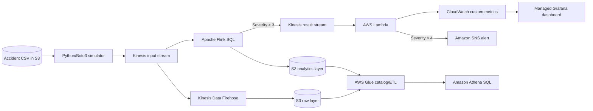

# Real-Time Accident Analysis Using Apache Flink and Amazon Kinesis

## 1. Project in one sentence

This project is a proof-of-concept streaming data pipeline that replays historical US accident records as live events, filters serious accidents in real time with Apache Flink SQL, records operational metrics, sends alerts, and supports both live dashboards and later batch analysis.

## 2. What problem does it solve?

Accident information loses much of its operational value when it arrives late. A severe accident may require traffic control, emergency response, public warnings, or route changes within minutes. A traditional batch pipeline might collect records for hours and process them overnight, which is useful for historical reporting but too slow for an immediate response.

This project demonstrates how to handle that **time-sensitive, or perishable, data** as a continuous stream. Its intended outcomes are:

- detect high-severity accidents soon after an event arrives;
- notify an operations team about the most critical events;
- expose accident counts by severity, city, and county for monitoring;
- retain raw and processed data for historical SQL analysis; and
- decouple producers, processors, alerts, dashboards, and storage so that they can scale independently.

The repository uses a static CSV because it is a demonstration. In a production system, the producer could be a road sensor, police feed, connected vehicle, mobile application, or external traffic API.

## 3. Business value

The system reduces the time between receiving an accident report and acting on it. A traffic operations center could use the same pattern to:

- alert staff when a severe event occurs;
- watch geographic hotspots on a near-real-time dashboard;
- redirect traffic or prioritize emergency resources;
- analyze accident patterns and weather conditions historically; and
- add capacity without tightly coupling every downstream consumer to the source.

This repository proves the architecture and its data movement. It does not contain integrations with emergency dispatch systems, and it should not be described as a production emergency-response platform.

## 4. Dataset

The sample file is [`data/US_Accidents_Dec20_updated_100samples.csv`](data/US_Accidents_Dec20_updated_100samples.csv). Despite `100samples` in the filename, the checked-in file contains 99 data rows plus its header.

The records include:

- identity and severity: `ID`, `Severity`;
- event time: `Start_Time`, `End_Time`, `Weather_Timestamp`;
- position: start/end latitude and longitude, street, city, county, state, ZIP code;
- impact: distance affected and a text description;
- weather: temperature, humidity, pressure, visibility, wind, precipitation, and conditions; and
- road context: junctions, crossings, railways, traffic signals, stops, and time-of-day indicators.

The local sample has the following severity distribution:

| Severity | Records |
| ---: | ---: |
| 2 | 56 |
| 3 | 23 |
| 4 | 17 |
| 5 | 3 |

Most records are from Ohio. This is a small, geographically skewed demonstration sample, so it is suitable for proving the pipeline but not for drawing general conclusions about US accident patterns.

## 5. Architecture

The intended design is shown in [`Architecture.jpg`](Architecture.jpg).



The system has two paths:

1. The **hot path** handles urgent events: Kinesis → Flink → Kinesis → Lambda → CloudWatch/SNS.
2. The **cold path** retains data for later analysis: Kinesis/Firehose → S3 → Glue → Athena.

This combination is useful because alerting and dashboards require low latency, while historical queries benefit from inexpensive object storage and a query engine designed for analytical scans.

## 6. What each technology does

| Component | Responsibility | Why it fits |
| --- | --- | --- |
| Python and Boto3 | Read the CSV and publish JSON events | Simple way to simulate an application or IoT producer |
| Amazon S3 | Store source, raw, and processed data | Durable and inexpensive object storage |
| Amazon Kinesis Data Streams | Buffer and transport streaming events | Decouples producers and consumers and supports scalable ingestion |
| Amazon Managed Service for Apache Flink | Define the stream schema and continuously filter events | Stateful, low-latency stream processing with SQL and event-time support |
| Apache Zeppelin | Author and run the Flink SQL notebook | Interactive development interface for the Flink job |
| AWS Lambda | Process filtered Kinesis events | Event-driven compute without managing servers |
| Amazon CloudWatch | Store custom accident-count metrics | Operational monitoring and a Grafana data source |
| Amazon SNS | Send critical-accident notifications | Managed publish/subscribe notifications |
| Amazon Data Firehose | Deliver stream data to S3 | Managed buffering and delivery to the data lake |
| AWS Glue | Catalog data and, in the intended design, prepare analytics data | Makes S3 datasets discoverable by analytics services |
| Amazon Athena | Query historical data in S3 with SQL | Serverless ad hoc analysis |
| Amazon Managed Grafana | Visualize CloudWatch metrics | Near-real-time operational dashboards |

## 7. End-to-end flow, step by step

### Step 1: Store the source data

The accident CSV is placed in an S3 bucket. The sample producer expects a bucket and object key as its inputs. S3 acts as the durable source from which the demo can be replayed.

### Step 2: Simulate real-time events

[`01 - stream-data-app-simulation.py`](01%20-%20stream-data-app-simulation.py) downloads the entire CSV object through Boto3 and passes its rows to `csv.DictReader`.

For every row, the program:

1. converts the row dictionary to JSON;
2. parses `Start_Time`, `End_Time`, and `Weather_Timestamp`;
3. converts those fields to ISO-8601 timestamps so Flink can interpret them consistently;
4. adds `Txn_Timestamp` using the current time to represent when the simulated event was emitted;
5. calls `put_record` to publish it to a Kinesis stream;
6. uses `Severity` as the Kinesis partition key; and
7. waits 250 milliseconds to imitate a continuous event source.

The script runs the file three times, so the 99-row local sample would attempt to emit 297 records. At one record every 250 ms, the intentional delay alone is about 74.25 seconds, excluding network time.

### Step 3: Partition records in Kinesis

Kinesis hashes the partition key to choose a shard. Records with the same severity value are therefore ordered within their resulting shard. This is acceptable for a small demo, but `Severity` has only four values in the sample and can create uneven traffic. A production design would usually use a higher-cardinality key such as accident ID, device ID, or a composite geographic key, depending on ordering requirements.

### Step 4: Define the streaming source in Flink SQL

[`03 - sql-flink-us-accidents-demo-lab-2.zpln`](03%20-%20sql-flink-us-accidents-demo-lab-2.zpln) is an exported Apache Zeppelin notebook. It declares `us_accidents_stream` over a Kinesis stream and maps the incoming JSON fields to a Flink table schema.

The table treats `Txn_Timestamp` as event time and defines this watermark:

```sql
WATERMARK FOR Txn_Timestamp AS Txn_Timestamp - INTERVAL '5' SECOND
```

The watermark tells Flink that events may arrive up to approximately five seconds out of order. Watermarks become especially important for event-time windows, joins, and late-event handling. This notebook does not perform a windowed aggregation, but the definition prepares the table for those operations.

### Step 5: Filter serious accidents continuously

The notebook declares a second Kinesis-backed table and runs a continuous insert:

```sql
INSERT INTO us_accidents_stream_1_results
SELECT ID, Severity, City, County, Txn_Timestamp
FROM us_accidents_stream
WHERE Severity > 3;
```

Only severity 4 and 5 records should reach the result stream. The wide source event is also reduced to five fields, which lowers downstream payload size and exposes only the fields needed for the next stage.

### Step 6: Invoke Lambda from the result stream

Kinesis invokes [`05 - lambda_function.py`](05%20-%20lambda_function.py) with a batch of records. The function uses `iter_deaggregate_records` to support records produced with the Kinesis Producer Library aggregation format, then Base64-decodes each Kinesis payload and parses its JSON.

### Step 7: Publish monitoring metrics

For each event, Lambda sends a custom CloudWatch metric with value `1`, unit `Count`, and one-second storage resolution. It adds severity, city, and county as dimensions. A dashboard can sum these values over time to show accident volume for a chosen set of dimensions.

### Step 8: Send the highest-severity alert

The intended Lambda rule publishes to an SNS topic when `Severity > 4`. Given this dataset, that means severity 5 only. Subscribers to the topic could receive an email or another supported notification.

There are therefore two business thresholds:

- Flink routes severity 4 and 5 events to the operational path.
- Lambda alerts only for severity 5 events.

### Step 9: Visualize current conditions

CloudWatch is the metric store and Amazon Managed Grafana is the intended visualization layer. Typical panels could include accident count by severity, top cities/counties, event rate over time, and alert-level event count.

### Step 10: Retain and query history

The diagram shows Firehose delivering raw stream data to an S3 raw layer, plus an S3 analytics layer, Glue, and Athena. The purpose is to retain events cheaply, catalog their schema, and query trends with SQL after the immediate value of the stream has passed.

## 8. What is actually implemented in this repository

The repository contains:

- a Python simulator that reads an S3 CSV and writes to Kinesis;
- a sample accident CSV;
- a Zeppelin/Flink SQL notebook defining Kinesis source and sink tables and a severity filter;
- a Lambda handler that publishes CloudWatch metrics and attempts SNS alerts; and
- an architecture diagram and brief README.

The repository does **not** contain Infrastructure as Code, deployment automation, IAM policies, CloudFormation/Terraform, Firehose configuration, Glue jobs/crawlers, Athena queries, a Grafana dashboard definition, tests, or a dependency manifest. Those services appear in the intended architecture, but their deployable configuration cannot be verified from this codebase.

## 9. Important issues and limitations

You should be ready to discuss these points honestly. Finding them demonstrates engineering judgment.

### Configuration is inconsistent

- The producer writes to `us-accidents-data-stream-01` in `us-east-1`.
- The Flink source reads `prototyping-stream-01` in `eu-west-1`.
- The Flink sink writes `prototyping-stream-02` in `eu-west-1`.
- Lambda creates CloudWatch and SNS clients in `eu-west-1`.

As checked in, these pieces do not form one runnable pipeline. Stream names and regions must be aligned, preferably through environment variables or deployment parameters.

### The SNS severity comparison relies on an implicit type contract

The producer reads CSV values as strings. Flink defines `Severity` as `BIGINT`, so its JSON sink should emit a number and the intended path should work. However, Lambda does not validate or coerce that value explicitly. If a producer or schema change supplies a JSON string, this expression fails in Python 3:

```python
if json_document['Severity'] > 4:
```

Using `severity = int(json_document['Severity'])` before comparisons would make the contract explicit.

### The notebook records a cancelled job

The exported Zeppelin result shows that the tables were created, but the continuous `INSERT` job was cancelled. Cancellation can be a manual lifecycle action for an unbounded streaming job, so it does not by itself prove that the SQL is invalid. It does mean the repository does not contain evidence of a completed end-to-end run.

### Exception handling can lose data silently

Both Python files catch broad exceptions and print them. The producer then continues, and Lambda still returns success after per-record errors. Without retries, a dead-letter destination, an on-failure destination, or partial batch failure reporting, bad records can be skipped without remediation.

### CloudWatch dimensions can create high cardinality

City and county values can produce many unique metric combinations. Custom CloudWatch metrics are identified by their complete dimension set, so a nationwide production feed could create many metrics and significant cost. Logs plus metric filters, Embedded Metric Format, or a dedicated analytical store may fit high-cardinality analysis better.

### The producer is demo-oriented

It downloads the full S3 object into memory, splits it into lines, sends one record per API call, hard-codes resource identifiers, prints every response, and repeats the dataset three times. Production ingestion would use configuration, batching (`PutRecords`), structured logging, backoff/retries, checkpointing, and idempotency where required.

### Event-time semantics are simplified

`Txn_Timestamp` is processing/emission time created by the simulator, rather than the actual accident start time. This is useful for a live replay demo, but historical event-time analysis should normally use `Start_Time` and define a policy for late records.

### Security and operations are not defined

The code does not describe least-privilege IAM roles, encryption keys, private networking, retention periods, alarms, schema evolution, data-quality rules, observability, or disaster recovery. These would be required for a production design.

## 10. How to run the intended project

The repository is not currently a one-command deployment. The following is the logical setup sequence.

1. Create an S3 bucket and upload the accident CSV.
2. Create two Kinesis Data Streams: one input stream and one filtered-result stream.
3. Give the producer permission to read the S3 object and call `kinesis:PutRecord` on the input stream.
4. Update the producer bucket, object key, stream name, and AWS Region, or move them to environment variables.
5. Install Python dependencies such as `boto3` and `python-dateutil`, configure AWS credentials, and run the simulator.
6. Import the `.zpln` file into Zeppelin in an Apache Flink environment.
7. Change the notebook stream names and Region to the resources created in step 2.
8. Run the Flink SQL so the continuous insert filters severity greater than 3 into the result stream.
9. Package Lambda with its `aws-kinesis-agg` dependency and configure the result stream as its event source.
10. Set Lambda environment variables: `cloudwatch_namespace`, `cloudwatch_metric`, and `topic_arn`.
11. Give Lambda permission to consume the stream, write CloudWatch metrics, publish to the SNS topic, and write logs.
12. Subscribe and confirm an email or another endpoint on the SNS topic.
13. Configure Grafana to use CloudWatch and build accident-count panels.
14. To implement the historical path, configure Firehose delivery to S3, create Glue catalog resources, and query the data through Athena.
15. Send test events for severities 2 through 5 and verify filtering, metrics, alerts, failed-record handling, and dashboard behavior.

Before attempting this sequence, fix the region/stream-name inconsistency and make the Lambda severity conversion explicit.

## 11. How to explain it in an interview

### A 30-second answer

> I built a proof-of-concept real-time accident analytics pipeline on AWS. A Python/Boto3 producer replays accident records from S3 into Kinesis. Apache Flink SQL reads the stream, applies event-time semantics, and routes severity 4 and 5 accidents to a second stream. Lambda consumes those events, writes dimensions such as severity and location to CloudWatch, and uses SNS for severity 5 alerts. Grafana is the visualization layer, while S3, Glue, and Athena form the historical analytics path. The main problem it addresses is reducing the delay between an accident event and an operational response.

Only say “built” for components you personally implemented and ran. If you studied or extended this repository, say “implemented a prototype from this architecture,” “reproduced,” or “analyzed,” as appropriate.

### A 2-minute answer

> The problem was that accident data is time-sensitive. If it is processed only in a nightly batch, it is useful for reports but too late for immediate action. I designed a hot path and a cold path. In the hot path, a Python application reads sample records from S3, normalizes three timestamp fields to ISO-8601, adds an ingestion timestamp, and publishes JSON records to Kinesis. I used severity as the demo partition key. Flink SQL declares a schema over the stream, assigns a five-second watermark, and continuously filters events where severity is greater than 3 into another Kinesis stream. A Lambda consumer then emits CloudWatch metrics by severity, city, and county, and sends an SNS notification for the highest severity. Grafana can visualize the CloudWatch metrics. In the cold path, Firehose and S3 retain data so Glue and Athena can support historical analysis.
>
> The main tradeoffs are also important. Severity is a low-cardinality partition key, so I would replace it for better shard distribution. City and county create high-cardinality CloudWatch metrics, which can be expensive. I would externalize the hard-coded configuration, batch producer writes, add retry and dead-letter handling, and deploy the resources with Terraform or CloudFormation. I also found that the checked-in stream names and AWS Regions do not match, so aligning configuration is necessary before an end-to-end deployment.

### A deeper technical walkthrough

Use this order when the interviewer asks for details:

1. **Start with the problem:** batch processing has too much latency for operational accident response.
2. **State the input contract:** JSON events derived from accident CSV rows, including time, geography, weather, and severity.
3. **Explain ingestion:** Boto3 sends records to Kinesis, which buffers traffic and separates the producer from consumers.
4. **Explain partitioning:** a partition key controls shard placement and ordering; severity was simple for the demo but is not ideal at scale.
5. **Explain processing:** Flink SQL gives continuous filtering and supports event-time operations through timestamps and watermarks.
6. **Explain the thresholds:** severity greater than 3 enters the monitoring path; severity greater than 4 triggers the critical alert.
7. **Explain serving:** Lambda converts events into CloudWatch metrics, SNS produces notifications, and Grafana reads the metrics.
8. **Explain retention:** S3 keeps raw/curated history, Glue describes it, and Athena queries it without provisioning a database cluster.
9. **Close with reliability and scale:** retries, checkpoints, idempotency, dead-letter handling, monitoring, schema governance, secure IAM, and Infrastructure as Code.

## 12. Likely interview questions and strong answers

### Why use Kinesis instead of calling Lambda directly?

Kinesis buffers bursts, retains records for replay, supports multiple consumers, and lets the producer and consumers scale independently. Direct invocation creates tighter coupling and offers less flexibility for replay and additional consumers.

### Why use Flink if the current transformation is only a filter?

For only one filter, Lambda event-source filtering could be simpler and cheaper. Flink becomes justified when the pipeline grows to include event-time windows, streaming aggregations, joins, state, pattern detection, and late-event handling. This project demonstrates the foundation for those operations.

### What is a watermark?

A watermark is Flink's estimate that event time has advanced to a point. The five-second watermark allows bounded out-of-order arrival and helps Flink decide when event-time windows can be evaluated. Data later than the policy needs explicit handling.

### What delivery guarantee does the system have?

Kinesis-to-Lambda processing is generally at least once, so duplicates are possible. Flink can provide checkpoint-based state consistency when its sources and sinks support it. An external side effect such as an SNS notification still needs an idempotency strategy if duplicate alerts are unacceptable.

### How would you handle malformed events?

Validate against a schema, log a correlation ID and validation reason, route invalid records to a quarantine stream or S3 prefix, alarm on the failure rate, and replay corrected records. Lambda should report partial batch failures so successful records are not unnecessarily retried with failed ones.

### How would you scale it?

Monitor incoming bytes, records, iterator age, Flink backpressure, checkpoint duration, Lambda concurrency, errors, and throttles. Increase Kinesis shard capacity or use on-demand mode, choose a well-distributed partition key, scale Flink parallelism, batch writes, and control downstream concurrency.

### Why have both CloudWatch/Grafana and Athena?

They serve different access patterns. CloudWatch and Grafana provide operational views over recent metrics. S3 and Athena retain detailed history for exploratory SQL and longer-term analysis at a lower storage cost.

### How would you avoid duplicate SNS alerts?

Use the accident ID plus alert type/version as an idempotency key in a conditional DynamoDB write before publishing. Also define whether an updated accident should generate a new alert and how long deduplication state should live.

### How would you improve the partition key?

The answer depends on the required ordering. Accident ID distributes independent accidents well. A hash of location plus a time bucket can preserve useful locality while spreading load. The key should have enough cardinality to avoid hot shards and should preserve only the ordering the business actually needs.

### What would you monitor?

I would monitor producer failures and throttling; Kinesis write/read throughput and iterator age; Flink lag, backpressure, restarts, and checkpoints; Lambda errors, duration, concurrency, throttles, and event age; SNS publish failures; Firehose delivery failures; and data-quality measures such as null rates, schema failures, and event counts at each stage.

## 13. Resume wording

Choose wording that exactly matches what you completed.

### If you deployed and tested the full pipeline

**Real-Time Accident Analytics Pipeline — AWS, Apache Flink, Python, SQL**

- Built an event-driven pipeline that ingested JSON accident events through Amazon Kinesis and used Apache Flink SQL to route high-severity incidents for low-latency processing.
- Developed a Python/Boto3 event simulator and a Lambda consumer that produced CloudWatch metrics and SNS alerts for critical incidents.
- Implemented a hot path for operational monitoring and a data-lake path using S3, Glue, and Athena for historical analysis, with Grafana dashboards for visualization.
- Improved reliability with `<insert what you actually implemented: retries, DLQ, checkpoints, alarms, Infrastructure as Code, tests>` and validated `<insert measured event rate/latency>`.

### If you only ran the checked-in prototype

**Real-Time Accident Analytics Prototype — AWS, Apache Flink, Python, SQL**

- Implemented a streaming prototype that replayed US accident records from S3 through Kinesis and filtered severity 4–5 events with Flink SQL.
- Processed filtered events in Lambda to generate CloudWatch metrics and SNS notifications, and evaluated the design's scaling, reliability, and partitioning tradeoffs.
- Identified configuration, data-type, high-cardinality metric, and failure-handling gaps and proposed production improvements.

Do not add latency, throughput, cost reduction, or availability numbers unless you measured them. Interviewers often ask how each number was obtained.

## 14. STAR-format story

**Situation:** Accident data was available, but batch processing could not support timely operational awareness.

**Task:** Design a pipeline that could ingest a continuous event feed, identify serious incidents, notify operators, show live metrics, and preserve records for historical analysis.

**Action:** I used a Python/Boto3 producer to replay S3 records into Kinesis, normalized timestamps, defined the stream schema and a watermark in Flink SQL, filtered severity 4 and 5 events into a result stream, and used Lambda to publish CloudWatch metrics and severity 5 SNS alerts. I separated the immediate processing path from an S3/Glue/Athena analytics path. I also reviewed partitioning, error handling, metric cardinality, and configuration consistency.

**Result:** The prototype demonstrates how accident events can move from ingestion to filtering, monitoring, and alerting within a streaming architecture. Replace this sentence with measured results after running a load test, such as end-to-end p95 latency, sustained records per second, alert success rate, and observed recovery behavior.

## 15. Honest ownership checklist

Before an interview, be able to say which of these you personally did:

- wrote or modified the producer;
- created and configured the Kinesis streams;
- wrote or ran the Flink SQL;
- configured checkpoints and tested recovery;
- packaged and deployed Lambda dependencies;
- created the CloudWatch metrics and Grafana dashboard;
- configured and confirmed SNS subscriptions;
- built the Firehose, S3, Glue, and Athena path;
- defined IAM permissions and encryption;
- load-tested the system and measured latency/throughput; and
- diagnosed the current region, stream-name, and severity-type issues.

If an interviewer asks about a component that was architectural rather than implemented, say so directly and explain how you would implement and validate it.

## 16. Recommended next improvements

1. Centralize stream names, bucket names, topic ARN, and Region in environment variables or deployment parameters.
2. Convert and validate severity and all required fields at the producer and consumer boundaries.
3. Add a dependency file and reproducible Lambda packaging process.
4. Add Infrastructure as Code for streams, IAM, Lambda, SNS, Firehose, Glue, Athena, CloudWatch, and Grafana.
5. Replace one-at-a-time `PutRecord` calls with `PutRecords`, retries with exponential backoff, and delivery-result checks.
6. Add partial batch response handling and a failed-event destination for Lambda.
7. Choose a higher-cardinality partition key after documenting ordering requirements.
8. Reconsider high-cardinality CloudWatch dimensions and put detailed geographic analytics in an appropriate store.
9. Add Flink checkpointing, restart strategy, schema evolution, late-data handling, and data-quality rules.
10. Create repeatable integration/load tests and report measured p50/p95/p99 latency, throughput, failure recovery, and cost.

These improvements turn the repository from a teaching prototype into a stronger portfolio project and give you concrete engineering decisions to discuss in an interview.

For a critical production assessment, live-data API options, a target architecture, and a phased Terraform plan, continue with [`PRODUCTION_READINESS_AND_TERRAFORM.md`](PRODUCTION_READINESS_AND_TERRAFORM.md).

For the complete visual architecture, sequence diagrams, failure paths, Terraform dependency map, and recommended build order, see [`ARCHITECTURE_WORKFLOW.md`](ARCHITECTURE_WORKFLOW.md).
