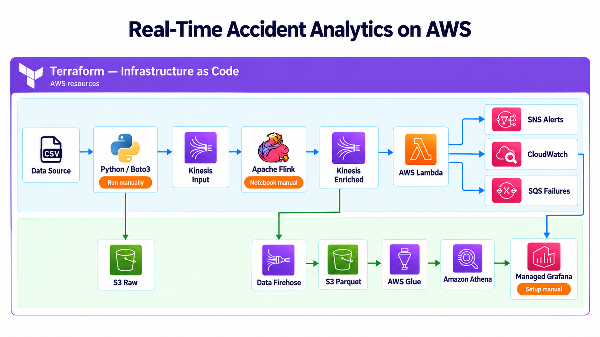

# Realtime-Accident-Analysis-Using-Flink-Kinesis

**Business Overview**

Perishable data is information whose value can significantly decline over a period of time. When the operating conditions change to the point that the knowledge is no longer helpful, the information loses a large amount of its value. This information is frequently produced in an IoT computing context. Managing perishable data provides a number of benefits. Real-time data provides you with the information you need almost instantly and in the context which helps make smarter business decisions. The use of data from edge computing devices speeds up reaction time and minimizes time to action. Such data does not need to be kept in data centers for a long time and maybe deleted after usage, saving storage space and money. Systems are usually designed on constant patterns and can’t scale with peaks in the load resulting in latency and server failures.

This Project will simulate real-time accident data and architect a pipeline that will help us analyze and take quick actions using AWS Kinesis, Apache Flink, Grafana, and Amazon SNS.

**Data Pipeline**

A data pipeline is a technique for transferring data from one system to another. The data may or may not be updated, and it may be handled in real-time (or streaming) rather than in batches. The data pipeline encompasses everything from harvesting or acquiring data using various methods to storing raw data, cleaning, validating, and transforming data into a query-worthy format, displaying KPIs, and managing the above process.

**Dataset Description**

This Project uses the US car accidents dataset which includes a few of the following fields:

- Severity
- Start_Time
- End_Time
- Location
- Description
- City
- State

**Tech Stack:**

➔ Languages - SQL, Python3

➔ Services - AWS S3, AWS Glue, AWS Athena, Amazon Data Firehose, Apache Flink, Amazon Kinesis, Amazon SNS, Amazon SQS, AWS Lambda, Amazon CloudWatch, Amazon Managed Grafana, Apache Zeppelin, Terraform

**Architecture Diagram**

## Terraform deployment

The complete deployable environment is defined in [`data/infra/`](data/infra/README.md). It provisions the S3 raw and curated layers, two encrypted Kinesis streams, Firehose JSON-to-Parquet delivery, Glue catalog tables, Athena queries, Lambda consumer, SNS alerts, SQS failure handling, CloudWatch monitoring, optional Managed Grafana, IAM policies, and environment-specific Flink SQL.

Firehose consumes the Flink-enriched stream, so the real-time Lambda path and the historical Athena/Grafana path analyze the same processed events.

For complete Windows installation, AWS authentication, deployment, Flink Studio, verification, troubleshooting, and cleanup instructions, follow [`SETUP_AND_RUN_GUIDE.md`](SETUP_AND_RUN_GUIDE.md).

## Documentation guide

Choose the guide that matches your task:

| Goal | Start here |
| --- | --- |
| Understand the project and its components | [Project explanation](PROJECT_EXPLANATION.md) |
| Follow the architecture and event flow | [Architecture workflow](ARCHITECTURE_WORKFLOW.md) |
| Install tools, configure AWS, and run the demo | [Setup and run guide](SETUP_AND_RUN_GUIDE.md) |
| Deploy supporting infrastructure with Terraform | [Infrastructure README](data/infra/README.md) |
| Find operational commands | [Command reference](COMMAND_REFERENCE.md) |
| Review production considerations | [Production readiness and Terraform](PRODUCTION_READINESS_AND_TERRAFORM.md) |

### Deployment boundaries

Terraform provisions the supporting AWS infrastructure and generates environment-specific Flink SQL. **Flink Studio notebook creation and SQL execution remain manual steps.** Grafana access and dashboards also require configuration after workspace creation. Follow the infrastructure README for these boundaries and the teardown procedure.

### Interpreting the demo

The producer replays accident records from a sample CSV to simulate a stream. The project demonstrates streaming architecture; it is not a live accident-detection service. Deployment instructions describe the intended setup, rather than a benchmark or proof of production readiness.
